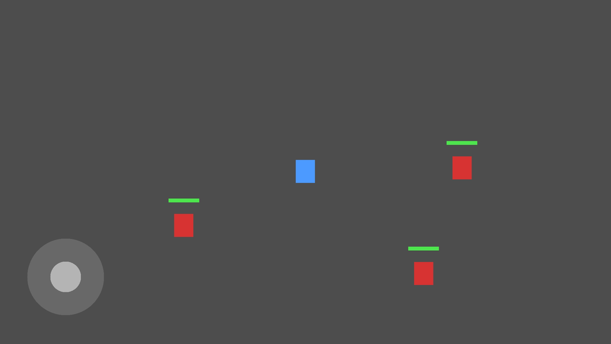

# Star Patrol

A pixel-art action RPG for mobile with planned 1–4 player co-op, set in a world where sci-fi and dark fantasy blend. Players start as a blank recruit in the Star Patrol, a guild of fortune hunters, pick one of 6 classes and raid the ruins of a fallen star empire for loot.

Built with **Godot 4** (GDScript).



## Status: prototype, step 5 next

Working so far (placeholder shapes, no art yet):

- On-screen joystick movement (WASD / arrow keys also work on a computer)
- Tap or click an enemy to target it (red ring)
- Auto-attack when the target is in range; enemies flash, lose HP and disappear
- Flame Warden Heat gauge (top-left) and two skill buttons (bottom-right, or keys 1 and 2):
  - **Strike**: heavy hit on your target, builds Heat (needs the target in range)
  - **Ring**: burns all enemies around you, costs 40 Heat
- A Hollow Throne room (the scene that opens when you press play): enemies chase you and hit back, a wave of 4 enemies, then the Throne Guardian boss. Clear both and the door opens; walk through it to win. You heal between waves, and the room restarts if you fall

## Running it

1. Install [Godot 4.7 or newer](https://godotengine.org/download) (the standard version, not .NET).
2. Clone or download this repository.
3. In Godot's Project Manager, click **Import** and choose this folder's `project.godot`.
4. Press **F5** to play. Drag the joystick in the bottom-left with the mouse, and click an enemy to target it, then walk up to it to auto-attack.

### With the Godot editor on Android

1. Install **Godot Editor** from the Play Store.
2. On GitHub, tap **Code > Download ZIP**.
3. In Godot's Project Manager, tap **Import**, go up to `/storage/emulated/0`, open **Download** and pick the ZIP. Choose a folder to extract it to.
   If the Download folder looks empty, allow Godot to manage all files in **Android Settings > Apps > Godot Editor > Permissions**.
4. Open the project and tap **▶** (top right).

### Testing on an Android phone

1. In Godot, open **Editor > Manage Export Templates** and download the templates for your version.
2. Install Java (JDK 17) and the Android SDK, then set their paths in **Editor > Editor Settings > Export > Android**.
3. Add an Android preset in **Project > Export**. (`export_presets.cfg` is git-ignored, so each computer sets this up once.)
4. Turn on USB debugging on the phone and plug it in. Godot's **Remote Deploy** button (top right) then installs and runs the game on it.

## Project layout

```
project.godot          Project settings (mobile renderer, touch emulation, pixel-art filtering)
scenes/hollow_throne.tscn  The first dungeon room (main scene)
scenes/enemy.tscn      Basic enemy
scenes/boss.tscn       Throne Guardian boss (same script, bigger numbers)
scenes/main.tscn       Sandbox: player and 3 enemies in an open space
scripts/player.gd      Movement, HP and auto-attack (base for all classes)
scripts/flame_warden.gd  Flame Warden: Heat gauge, Flame Strike, Ember Ring
scripts/heat_bar.gd    Heat gauge display
scripts/skill_button.gd  Round on-screen skill button with cooldown sweep
scripts/enemy.gd       HP, chasing and attacking, damage flash, HP bar and target ring
scripts/wall.gd        Solid wall block, sized in the Inspector (visible in the editor)
scripts/room_director.gd  Waves, boss, door, exit, messages and restart
scripts/virtual_joystick.gd  Multitouch on-screen joystick
scripts/main.gd        Tap-to-target, default movement keys and skill keys
docs/SETUP.md          How the scene is built, D-pad setup and tunable numbers
```

## Prototype roadmap

1. ~~Learn the basics~~
2. ~~Movement and combat (joystick, tap-to-target, auto-attack)~~
3. ~~Warrior skills and the Flame Warden's Heat gauge~~
4. ~~One Hollow Throne dungeon room~~
5. **Layered sprites (base body plus one swappable armor piece)** (next)
6. 2-player online co-op

## Glossary

- **Flame Warden**: a Warrior specialization built around heat and fire.
- **Heat gauge**: the Flame Warden's class resource (0–100). Attacks build it, it cools after 3 seconds out of combat, and Ember Ring spends it.
- **Hollow Throne**: a ruined dungeon from the fallen star empire, used for the first test room.
- **Throne Guardian**: the boss at the end of the first Hollow Throne room.

## License

Copyright © 2026 heytylo-png. All rights reserved.

The source is public so you can read it and follow development, but you may not copy, modify, redistribute or publish it, or its art, story or names, without written permission.
